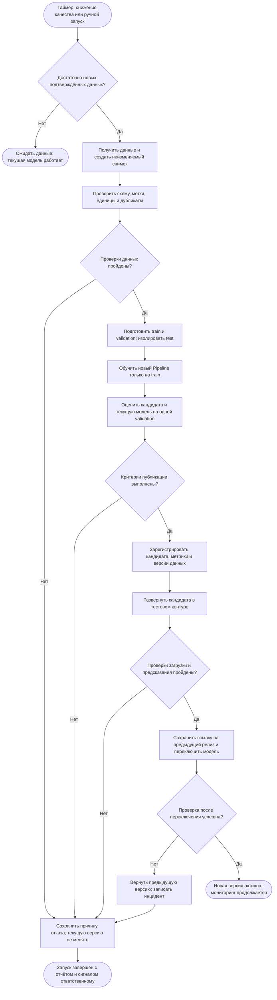
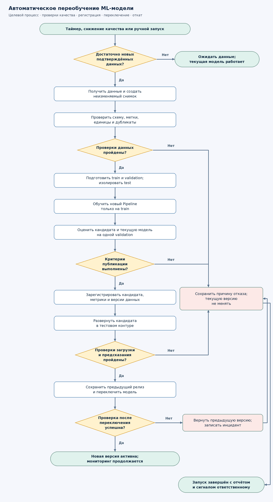

# Автоматическое переобучение модели проекта «Каталог ирисов»

## Назначение процесса

Проект «Каталог ирисов» использует Pipeline из StandardScaler и LogisticRegression для определения вида цветка: setosa, versicolor или virginica. Вход — длина и ширина чашелистика и лепестка в сантиметрах. Прогноз подтверждает сотрудник; только подтверждённые метки поступают в новые обучающие данные.

Схема описывает проектируемый процесс от события запуска до переключения на новую версию или сохранения действующей. Исходная версия модели — `iris-logreg-v1.0.0`. Оркестрация, реестр релизов и промышленное развёртывание относятся к целевой архитектуре.

## Триггеры запуска

Основной триггер — еженедельная проверка по понедельникам в 03:00 по московскому времени. Внеплановый запуск создаётся, если macro-F1 действующей модели на последних 100 подтверждённых наблюдениях ниже 0.90. Пока нет 100 подтверждений, этот сигнал не рассчитывается. ML-инженер также может создать ручной запуск после исправления ошибки данных или кода.

Любое событие проходит одно предварительное условие: с прошлого успешного релиза накоплено не менее **30 новых подтверждённых наблюдений**, включая минимум 5 каждого вида. Без достаточных данных запуск завершается статусом `waiting_for_data`; действующая модель продолжает работать. Повторные события для одной версии данных объединяются, одновременные релизы блокируются.

Параметры запуска уточняются после накопления данных реального питомника.

## Схема процесса

PNG-версия: [assets/model_retraining.png](assets/model_retraining.png).

## Этапы, входы и результаты

| № | Этап | Что происходит | Результат для следующего шага |
| ---: | --- | --- | --- |
| 1 | Приём триггера | Планировщик или мониторинг создаёт запуск; проверяются новые метки и блокировка релиза | `run_id`, причина запуска и версия действующей модели |
| 2 | Получение данных | Выгружаются измерения и подтверждённые сотрудником виды, добавляется ранее разрешённый train | Неизменяемый снимок с идентификаторами, временем и SHA-256 |
| 3 | Проверка данных | Проверяются признаки, метки, пропуски, единицы, повторные записи и конфликты разметки | Отчёт качества и допуск к подготовке либо отказ |
| 4 | Подготовка выборок | Исключаются test и дубликаты; выделяется validation, соблюдается стратификация | Непересекающиеся train/validation и перечни их идентификаторов |
| 5 | Обучение | StandardScaler и LogisticRegression обучаются только на train | Кандидат Pipeline, параметры обучения и журнал запуска |
| 6 | Оценка | Кандидат и действующая версия прогнозируют одну validation | Macro-F1, accuracy, recall по видам, матрицы ошибок и сравнение версий |
| 7 | Решение о публикации | Автоматически применяются все критерии допуска | Решение `approved` или `rejected` с причинами |
| 8 | Регистрация | Одобренный Pipeline сохраняется под новой неизменяемой версией | Артефакт, его контрольная сумма, метрики, версии данных и среды |
| 9 | Проверка развёртывания | Кандидат загружается отдельно от активной модели; выполняются контрольные запросы | Отчёт технических проверок и готовый релиз |
| 10 | Переключение | Сохраняется предыдущий релиз; указатель активной модели атомарно меняется | Активная новая версия либо откат |
| 11 | Проверка после переключения | Контролируются версия, доступность и корректность ответов | Завершение релиза или возврат к предыдущему артефакту |
| 12 | Мониторинг | Накапливаются подтверждения, оцениваются качество и доля ручного рассмотрения | Метрики эксплуатации и новые события переобучения |

## Правила получения и проверки данных

Для обучения принимаются только четыре измерения в сантиметрах и метка, подтверждённая сотрудником. Прогноз модели не заменяет подтверждение. Идентификаторы, время и история исправлений сохраняются как служебные поля, но не подаются в признаки.

1. Должны присутствовать все четыре конечных положительных числовых признака.
2. Метка должна входить в `setosa`, `versicolor`, `virginica`. Новый вид требует изменения задачи и отдельного согласования схемы классов.
3. Единицы измерения проверяются по метаданным формы; необычные значения передаются на ручную проверку. Автоматически исправлять сантиметры на миллиметры нельзя.
4. Повторная выгрузка того же `sample_id` не создаёт новую запись. Полные дубликаты удаляются до разбиения. Одинаковые измерения с противоречащими метками блокируют запуск до проверки специалистом.
5. Объекты действующей validation, предложенной новой validation и закрытого test не могут попадать в train. Для повторно измеренного растения все записи удерживаются в одной выборке по `plant_id`, если такой идентификатор доступен.
6. После очистки должно остаться не менее 30 новых подтверждений, включая минимум 5 каждого вида. Неуспешная проверка не должна приводить к публикации модели на неполных данных.

Перед обучением фиксируются снимок данных, правила очистки, код и версия библиотек. Внешние разметки и файлы после начала запуска не меняют его входы.

## Подготовка данных и защита от утечки

Для воспроизводимого первого прототипа используются 89/30/30 объектов train/validation/test с `random_state=42`; в validation и test представлены по 10 объектов каждого вида. Macro-F1 исходной версии на validation равен 0.966583, на test — 0.933333. Для будущего релиза новые подтверждённые объекты делятся на train и validation стратифицированно; группы одного растения не пересекаются. На новой validation должно быть минимум 10 наблюдений каждого вида с учётом ранее выделенного контрольного набора. Если это невозможно, релиз откладывается.

Текущая модель и кандидат сравниваются на одной закреплённой для этого запуска validation. Её метки используются для решения о допуске, но не для обучения. Закрытый test не используется для каждого автоматического запуска. Он предназначен для отдельного независимого аудита; после изучения результатов дальнейший независимый аудит требует новой отложенной выборки. Контрольный набор периодически обновляется новыми подтверждёнными наблюдениями, чтобы снизить риск подстройки под многократно просмотренную validation.

Стандартизатор обучается только на train. Та же операция преобразования сохраняется внутри Pipeline и применяется при прогнозировании. После проверки модель не дообучается на validation: в релиз передаётся именно проверенный артефакт.

## Условия публикации новой версии

Кандидат допускается только при одновременном выполнении условий:

| Проверка | Условие |
| --- | --- |
| Данные | Все обязательные проверки пройдены; выборки не пересекаются |
| Основная метрика | Macro-F1 кандидата на validation ≥ 0.90 |
| Качество по видам | Recall каждого из трёх видов ≥ 0.80 |
| Сравнение с действующей моделью | Macro-F1 кандидата − macro-F1 текущей модели ≥ 0.01 на той же validation |
| Область применения | Не меняются состав, порядок и единицы признаков, три класса и политика ручного рассмотрения |
| Проверка артефакта | Pipeline загружается, выдаёт конечные вероятности и поддерживает ожидаемые вход и выход |
| Подготовка отката | Предыдущий релиз доступен и прошёл проверку загрузки |

Если качество сохранилось, но улучшение меньше 0.01, кандидат не заменяет действующую версию. Снижение качества в мониторинге запускает попытку переобучения, но само по себе не разрешает публикацию. В первой установке действующей ML-версии нет: используется абсолютный порог и сравнение с `DummyClassifier` как отправной точкой; правило +0.01 между ML-версиями применяется со следующего релиза.

Пороги задаются до оценки кандидата. Их нельзя снижать по итогам неудачного запуска только для прохождения проверки. Из-за малого объёма validation надёжность решения ограничена; перед реальной эксплуатацией требуется расширение данных.

## Регистрация и деплой

Одобренная версия получает отдельный идентификатор, например `iris-logreg-v1.0.1`. Вместе сохраняются Pipeline, классы, порядок признаков, границы train, порог 0.80, параметры обучения, версии библиотек, контрольные суммы данных и модели, `run_id`, метрики и решение о допуске. Старый артефакт не перезаписывается.

Кандидат сначала загружается в тестовый контур. Проверяются: корректный запрос с четырьмя размерами; отказ на пропуске, `NaN` и отрицательном значении; ручное рассмотрение вне диапазона; правильное количество вероятностей; их конечность и сумма, близкая к единице; соответствие версии в ответе версии релиза.

После прохождения проверок указатель активной версии атомарно переключается на кандидата; сохраняется адрес предыдущей версии. Сразу выполняется контрольный запрос, затем в течение 10 минут — проверка доступности раз в минуту. Два последовательных сбоя или некорректная версия ответа вызывают автоматический откат. Релизы в этот период не выполняются параллельно.

Качество по новым размеченным объектам проверяется отдельно от доступности: оно становится известно после подтверждений сотрудников. Если после релиза macro-F1 на новых 100 подтверждениях ниже 0.90 и предыдущая версия лучше на этой же выборке хотя бы на 0.01, выполняется откат; иначе сохраняется ручной режим и создаётся задача на разбор данных. Если предыдущая версия недоступна, система переходит на ручное определение вида и сообщает об инциденте.

## Действия при неуспехе

| Сбой | Действие | Активная модель |
| --- | --- | --- |
| Недостаточно подтверждённых данных | Завершить со статусом ожидания; повторить при следующем событии | Текущая |
| Ошибка выгрузки, нарушение схемы, конфликт меток | Сохранить отчёт; остановить запуск; отправить сигнал ответственному | Текущая |
| Ошибка обучения | Сохранить журнал; не регистрировать кандидата как одобренного | Текущая |
| Критерии качества не выполнены | Сохранить метрики и причины отказа | Текущая |
| Ошибка регистрации или тестового развёртывания | Не переключать указатель | Текущая |
| Сбой после переключения | Восстановить указатель предыдущего релиза и проверить его | Предыдущая либо ручной режим |

Каждый запуск заканчивается записью статуса, причин, версий и ссылок на отчёты. Повторная попытка создаёт новый `run_id`, а не скрывает историю предыдущей. Ответственный ML-инженер получает сигнал о сбое.
